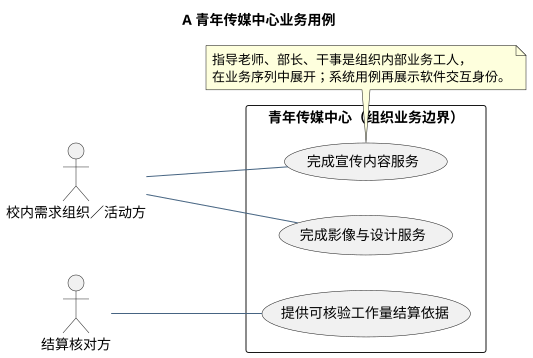
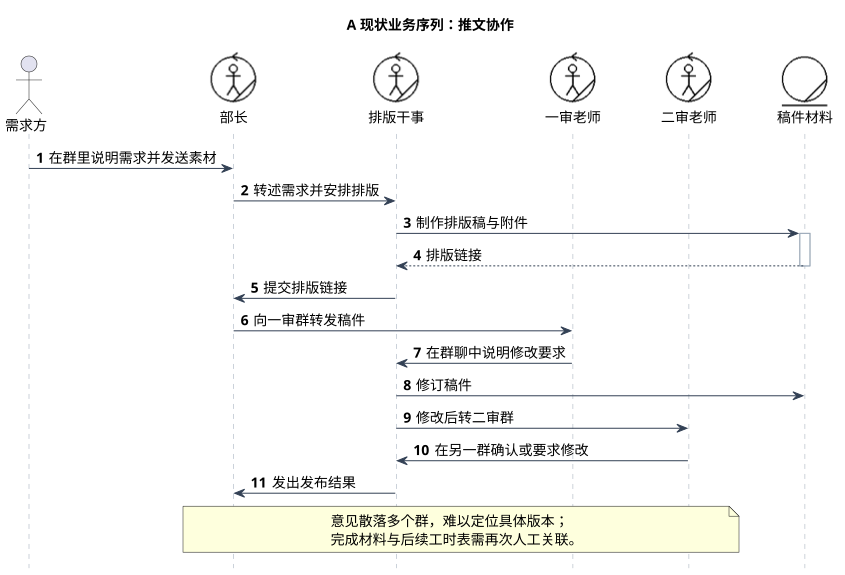
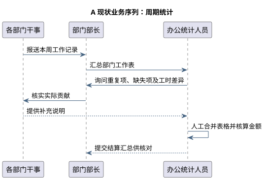
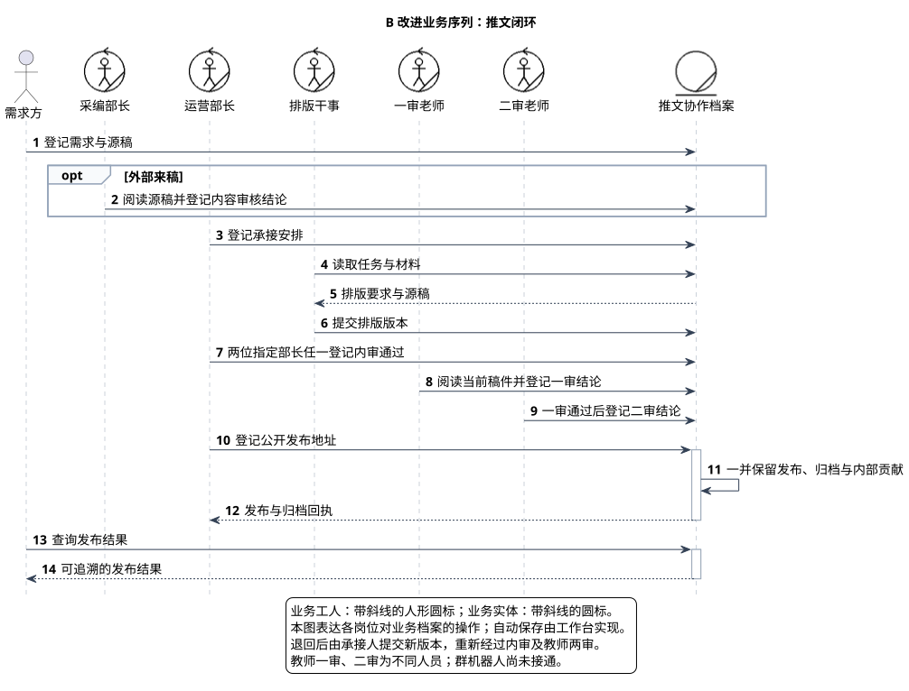
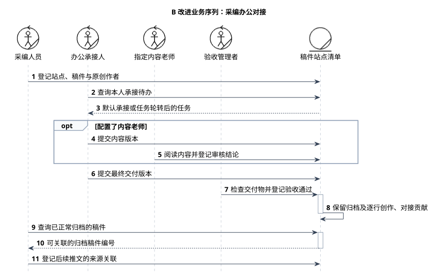
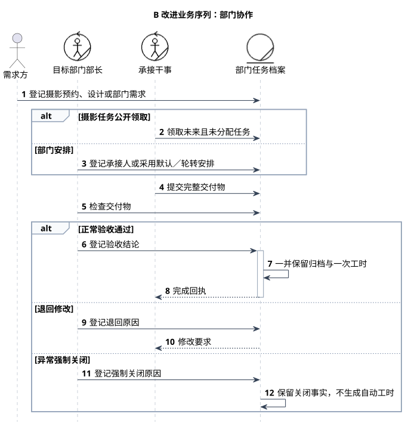
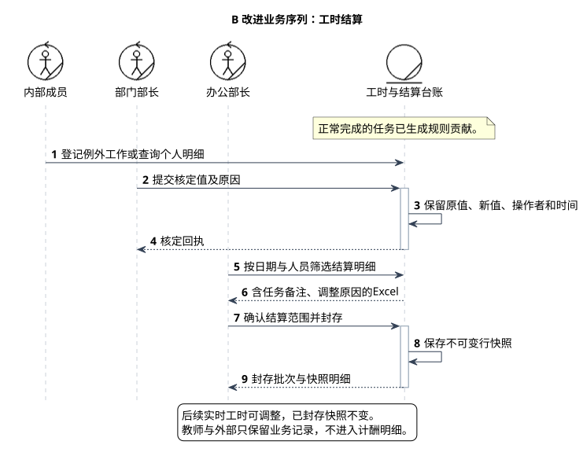

# A.2 业务建模与 B 需求形成

## 组织边界、业务执行者与涉众

业务边界是整个青年传媒中心。校内其他组织或活动需求方从边界外提出宣传、拍摄或设计需求，结算核对方关注可信工作量结果。中心内部的部长、干事和指导老师作为业务工人在序列中协作；他们操作软件时，又是软件边界外的系统参与者。业务执行者与系统参与者不能混用。

图形约定：业务序列使用PlantUML自定义业务工人（带斜线的人形圆标）和业务实体（带斜线的圆标）；任务档案、稿件清单、工时台账是业务实体。图中的记录操作由改进后的工作台支持，软件整体不充当业务实体。系统序列与分析序列另采用软件边界及BCE符号。

| 部门 | 核心工作 | 跨部门联系 |
| --- | --- | --- |
| 办公部 | 稿件对接、活动工作、工时核对及封存 | 与采编逐稿逐站点对接，与全中心结算 |
| 采编部 | 稿件内容、原创作者、源稿内容审核 | 给办公交付；外部来稿排版前审核 |
| 运营部 | 排版、内部审校、协调教师两审与发布 | 消化已归档稿件及外部来稿 |
| 摄制部 | 预约、承接、交付、验收 | 为活动方及其他部门供素材 |
| 美编部 | 基础、复杂、大型设计及验收 | 处理内部、外部和教师需求 |
| 原创部 | 原创需求及例外工作记录 | 无明确默认费率部分走人工登记 |

## 现状业务

需求方在群里发信息，部长转述并私下安排，成员通过链接和文件交付，老师在不同群里提出修改。办公部周期性收集各部门表格，人工辨认参与人、重复行和不同工时口径。现状图用于说明改造前问题，不代表当前系统仍按此实现。

主要问题是同一任务分散于多个群、意见与稿件版本难对应、完成后材料未集中归档、规则工时与人工核定缺乏解释。旧稿中“教师被简化”“部长承担老师二审”“办公按时段值班”等口径已由确认决定替代。

## 改进后的业务

推文以任务串起来源、采编内容审核、安排排版、运营内审、不同老师两审、发布和归档。两位指定运营部长均为审校岗位，任一确认即可送老师；老师审核记录保留但不计工时。退回后提交新排版版本，重新走完整排版审核链。

采编与办公共用稿件站点行。创作和对接以每行为单位，各自贡献分开；可选内容老师先审内容，最终交付再由管理人员验收。只有正常归档稿件可关联推文，不把不同频率的采编、排版和周期统计强塞进一个不可拆分业务。

摄制按预约时间开放领取或由部长安排；美编与其他部门需求按目标部门承接、提交和验收。固定承接可选，取消后按部门队列轮转后续任务，手工安排可覆盖尚未交付的安排。轮转是任务顺序，不是某人负责某个时段。

正常完成自动归档并按规则只生成一次贡献；强制关闭保留原因，不自动计时。人工登记补充无法由明确默认规则计算的工作。报表通过筛选、列配置和视图保存提升灵活性；核定差异有逐次审计，期末封存后保留当时快照。

## 自动化与人工责任

系统自动推导状态、校验权限和阶段、归档、计时、生成提醒意图。部长负责安排、验收和合理例外；老师对内容与推文质量负责。尚未接入的群机器人与订阅消息保留为未来外部渠道，当前站内待办不能当作微信群送达证据。
