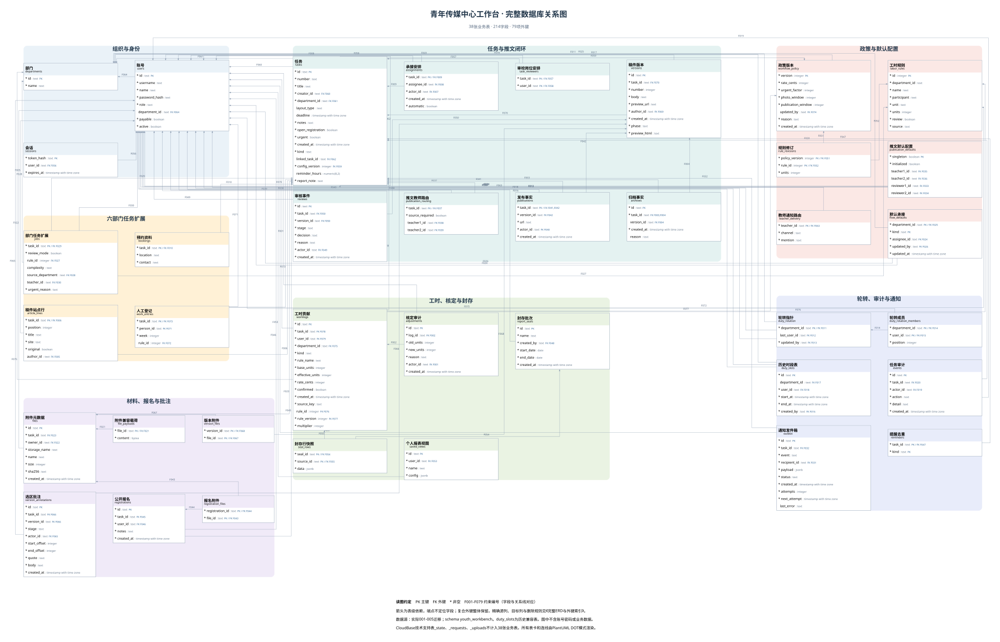

# 完整ERD与外键索引

完整大图把实际38张表、214个字段和79项外键放在同一画布；背景色只表示阅读分区，不是数据库schema。每张表只出现一次；跨区外键、同表自引用以及复合外键均保留。

- [SVG矢量大图](../diagrams/database/db-full.svg)：浏览器打开后放大查看。
- [单页矢量PDF](../diagrams/database/db-full.pdf)：适合大幅打印及缩放阅读。
- [完整PNG](../diagrams/database/db-full.png) · [PlantUML源文件](../diagrams/database/db-full.puml)

## 读图约定

每个字段保留实际名称、PostgreSQL类型、非空及主外键标记。F编号同时出现在字段和关系线上，下面的登记表精确列出源列、目标列与删除规则。复合外键的各字段共用同一编号，不拆成多个独立约束。

箭头表示表级依赖，由引用表指向被引用表；箭头在表边的位置不表示字段对应，精确字段由F编号定位。复合外键整体连接，不拆成独立关系。图源采用PlantUML的DOT模式固定表卡位置，避免自动布局把公共身份引用拉成超宽图。非空不等同于必有子记录；业务上的必须完成审核、计酬资格等由服务端规则保障。唯一、检查约束、默认值和索引完整定义见[数据字典](data-dictionary.md)。

## 全部外键

| 图中编号 | 来源表 | 约束名 | 精确约束 |
| --- | --- | --- | --- |
| F001 | adjustments | adjustments_actor_id_fkey | FOREIGN KEY (actor_id) REFERENCES users(id) |
| F002 | adjustments | adjustments_log_id_fkey | FOREIGN KEY (log_id) REFERENCES worklogs(id) |
| F003 | archives | archives_task_id_fkey | FOREIGN KEY (task_id) REFERENCES tasks(id) |
| F004 | archives | archives_task_id_version_id_fkey | FOREIGN KEY (task_id, version_id) REFERENCES versions(task_id, id) |
| F005 | article_lines | article_lines_author_id_fkey | FOREIGN KEY (author_id) REFERENCES users(id) |
| F006 | article_lines | article_lines_task_id_fkey | FOREIGN KEY (task_id) REFERENCES tasks(id) |
| F007 | assignments | assignments_actor_id_fkey | FOREIGN KEY (actor_id) REFERENCES users(id) |
| F008 | assignments | assignments_assignee_id_fkey | FOREIGN KEY (assignee_id) REFERENCES users(id) |
| F009 | assignments | assignments_task_id_fkey | FOREIGN KEY (task_id) REFERENCES tasks(id) |
| F010 | bookings | bookings_task_id_fkey | FOREIGN KEY (task_id) REFERENCES tasks(id) |
| F011 | duty_rotation | duty_rotation_department_id_fkey | FOREIGN KEY (department_id) REFERENCES departments(id) |
| F012 | duty_rotation | duty_rotation_last_user_id_fkey | FOREIGN KEY (last_user_id) REFERENCES users(id) |
| F013 | duty_rotation | duty_rotation_updated_by_fkey | FOREIGN KEY (updated_by) REFERENCES users(id) |
| F014 | duty_rotation_members | duty_rotation_members_department_id_fkey | FOREIGN KEY (department_id) REFERENCES duty_rotation(department_id) ON DELETE CASCADE |
| F015 | duty_rotation_members | duty_rotation_members_user_id_fkey | FOREIGN KEY (user_id) REFERENCES users(id) |
| F016 | duty_slots | duty_slots_created_by_fkey | FOREIGN KEY (created_by) REFERENCES users(id) |
| F017 | duty_slots | duty_slots_department_id_fkey | FOREIGN KEY (department_id) REFERENCES departments(id) |
| F018 | duty_slots | duty_slots_user_id_fkey | FOREIGN KEY (user_id) REFERENCES users(id) |
| F019 | events | events_actor_id_fkey | FOREIGN KEY (actor_id) REFERENCES users(id) |
| F020 | events | events_task_id_fkey | FOREIGN KEY (task_id) REFERENCES tasks(id) |
| F021 | file_payloads | file_payloads_file_id_fkey | FOREIGN KEY (file_id) REFERENCES files(id) ON DELETE CASCADE |
| F022 | files | files_owner_id_fkey | FOREIGN KEY (owner_id) REFERENCES users(id) |
| F023 | files | files_task_id_fkey | FOREIGN KEY (task_id) REFERENCES tasks(id) |
| F024 | flow_defaults | flow_defaults_assignee_id_fkey | FOREIGN KEY (assignee_id) REFERENCES users(id) |
| F025 | flow_defaults | flow_defaults_department_id_fkey | FOREIGN KEY (department_id) REFERENCES departments(id) |
| F026 | flow_defaults | flow_defaults_updated_by_fkey | FOREIGN KEY (updated_by) REFERENCES users(id) |
| F027 | jobs | jobs_rule_id_fkey | FOREIGN KEY (rule_id) REFERENCES labor_rules(id) |
| F028 | jobs | jobs_source_department_fkey | FOREIGN KEY (source_department) REFERENCES departments(id) |
| F029 | jobs | jobs_task_id_fkey | FOREIGN KEY (task_id) REFERENCES tasks(id) |
| F030 | jobs | jobs_teacher_id_fkey | FOREIGN KEY (teacher_id) REFERENCES users(id) |
| F031 | outbox | outbox_recipient_id_fkey | FOREIGN KEY (recipient_id) REFERENCES users(id) |
| F032 | outbox | outbox_task_id_fkey | FOREIGN KEY (task_id) REFERENCES tasks(id) |
| F033 | publication_defaults | publication_defaults_reviewer1_id_fkey | FOREIGN KEY (reviewer1_id) REFERENCES users(id) |
| F034 | publication_defaults | publication_defaults_reviewer2_id_fkey | FOREIGN KEY (reviewer2_id) REFERENCES users(id) |
| F035 | publication_defaults | publication_defaults_teacher1_id_fkey | FOREIGN KEY (teacher1_id) REFERENCES users(id) |
| F036 | publication_defaults | publication_defaults_teacher2_id_fkey | FOREIGN KEY (teacher2_id) REFERENCES users(id) |
| F037 | publication_routing | publication_routing_task_id_fkey | FOREIGN KEY (task_id) REFERENCES tasks(id) |
| F038 | publication_routing | publication_routing_teacher1_id_fkey | FOREIGN KEY (teacher1_id) REFERENCES users(id) |
| F039 | publication_routing | publication_routing_teacher2_id_fkey | FOREIGN KEY (teacher2_id) REFERENCES users(id) |
| F040 | publications | publications_actor_id_fkey | FOREIGN KEY (actor_id) REFERENCES users(id) |
| F041 | publications | publications_task_id_fkey | FOREIGN KEY (task_id) REFERENCES tasks(id) |
| F042 | publications | publications_task_id_version_id_fkey | FOREIGN KEY (task_id, version_id) REFERENCES versions(task_id, id) |
| F043 | registration_files | registration_files_file_id_fkey | FOREIGN KEY (file_id) REFERENCES files(id) |
| F044 | registration_files | registration_files_registration_id_fkey | FOREIGN KEY (registration_id) REFERENCES registrations(id) |
| F045 | registrations | registrations_task_id_fkey | FOREIGN KEY (task_id) REFERENCES tasks(id) |
| F046 | registrations | registrations_user_id_fkey | FOREIGN KEY (user_id) REFERENCES users(id) |
| F047 | reminders | reminders_task_id_fkey | FOREIGN KEY (task_id) REFERENCES tasks(id) |
| F048 | report_seals | report_seals_created_by_fkey | FOREIGN KEY (created_by) REFERENCES users(id) |
| F049 | reviews | reviews_actor_id_fkey | FOREIGN KEY (actor_id) REFERENCES users(id) |
| F050 | reviews | reviews_task_id_version_id_fkey | FOREIGN KEY (task_id, version_id) REFERENCES versions(task_id, id) |
| F051 | rule_revisions | rule_revisions_policy_version_fkey | FOREIGN KEY (policy_version) REFERENCES workflow_policy(version) |
| F052 | rule_revisions | rule_revisions_rule_id_fkey | FOREIGN KEY (rule_id) REFERENCES labor_rules(id) |
| F053 | saved_views | saved_views_user_id_fkey | FOREIGN KEY (user_id) REFERENCES users(id) |
| F054 | seal_rows | seal_rows_seal_id_fkey | FOREIGN KEY (seal_id) REFERENCES report_seals(id) |
| F055 | seal_rows | seal_rows_source_id_fkey | FOREIGN KEY (source_id) REFERENCES worklogs(id) |
| F056 | sessions | sessions_user_id_fkey | FOREIGN KEY (user_id) REFERENCES users(id) |
| F057 | task_reviewers | task_reviewers_task_id_fkey | FOREIGN KEY (task_id) REFERENCES tasks(id) |
| F058 | task_reviewers | task_reviewers_user_id_fkey | FOREIGN KEY (user_id) REFERENCES users(id) |
| F059 | tasks | tasks_config_version_fkey | FOREIGN KEY (config_version) REFERENCES workflow_policy(version) |
| F060 | tasks | tasks_creator_id_fkey | FOREIGN KEY (creator_id) REFERENCES users(id) |
| F061 | tasks | tasks_department_id_fkey | FOREIGN KEY (department_id) REFERENCES departments(id) |
| F062 | tasks | tasks_linked_task_id_fkey | FOREIGN KEY (linked_task_id) REFERENCES tasks(id) |
| F063 | teacher_delivery | teacher_delivery_teacher_id_fkey | FOREIGN KEY (teacher_id) REFERENCES users(id) |
| F064 | users | users_department_id_fkey | FOREIGN KEY (department_id) REFERENCES departments(id) |
| F065 | version_annotations | version_annotations_actor_id_fkey | FOREIGN KEY (actor_id) REFERENCES users(id) |
| F066 | version_annotations | version_annotations_task_id_version_id_fkey | FOREIGN KEY (task_id, version_id) REFERENCES versions(task_id, id) |
| F067 | version_files | version_files_file_id_fkey | FOREIGN KEY (file_id) REFERENCES files(id) |
| F068 | version_files | version_files_version_id_fkey | FOREIGN KEY (version_id) REFERENCES versions(id) |
| F069 | versions | versions_author_id_fkey | FOREIGN KEY (author_id) REFERENCES users(id) |
| F070 | versions | versions_task_id_fkey | FOREIGN KEY (task_id) REFERENCES tasks(id) |
| F071 | work_entries | work_entries_person_id_fkey | FOREIGN KEY (person_id) REFERENCES users(id) |
| F072 | work_entries | work_entries_rule_id_fkey | FOREIGN KEY (rule_id) REFERENCES labor_rules(id) |
| F073 | work_entries | work_entries_task_id_fkey | FOREIGN KEY (task_id) REFERENCES tasks(id) |
| F074 | workflow_policy | workflow_policy_updated_by_fkey | FOREIGN KEY (updated_by) REFERENCES users(id) |
| F075 | worklogs | worklogs_department_id_fkey | FOREIGN KEY (department_id) REFERENCES departments(id) |
| F076 | worklogs | worklogs_rule_id_fkey | FOREIGN KEY (rule_id) REFERENCES labor_rules(id) |
| F077 | worklogs | worklogs_rule_version_fkey | FOREIGN KEY (rule_version) REFERENCES workflow_policy(version) |
| F078 | worklogs | worklogs_task_id_fkey | FOREIGN KEY (task_id) REFERENCES tasks(id) |
| F079 | worklogs | worklogs_user_id_fkey | FOREIGN KEY (user_id) REFERENCES users(id) |
