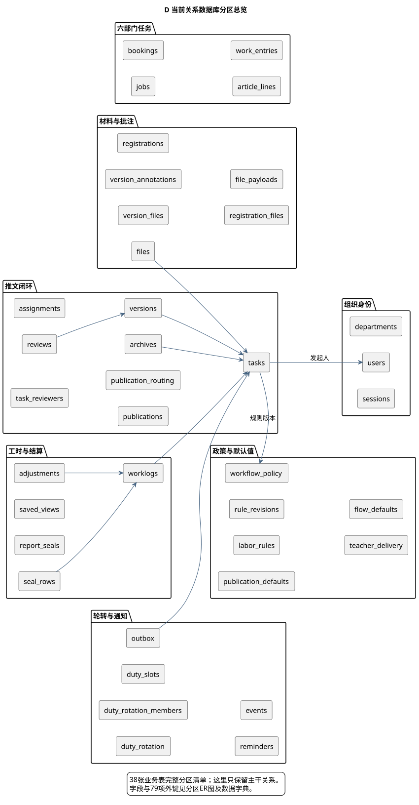
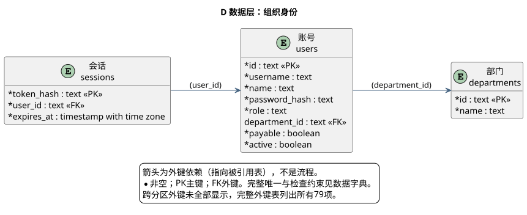
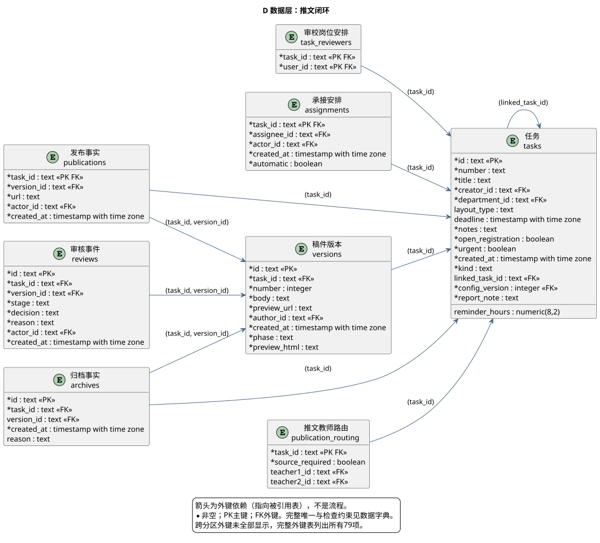
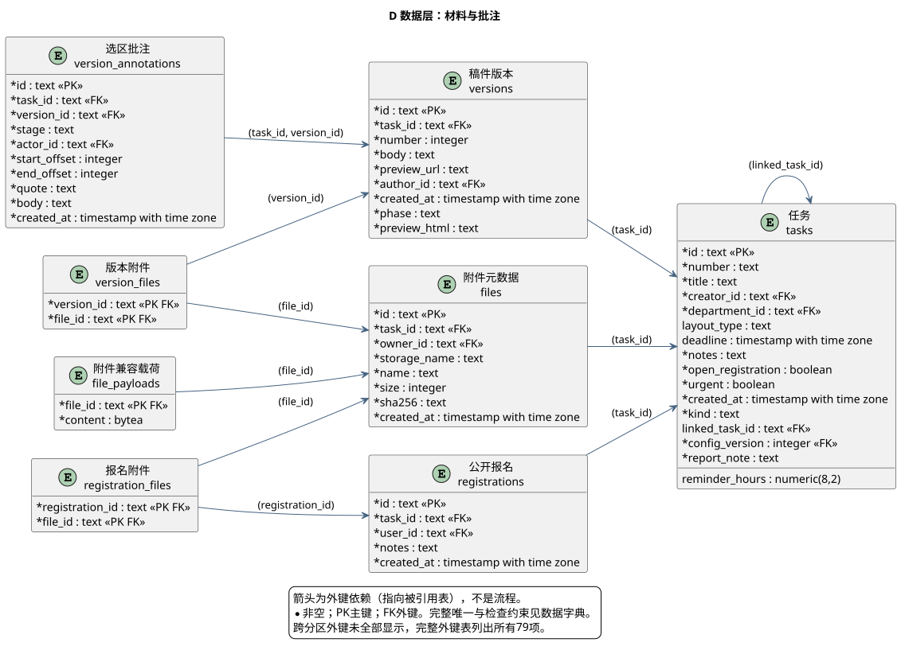
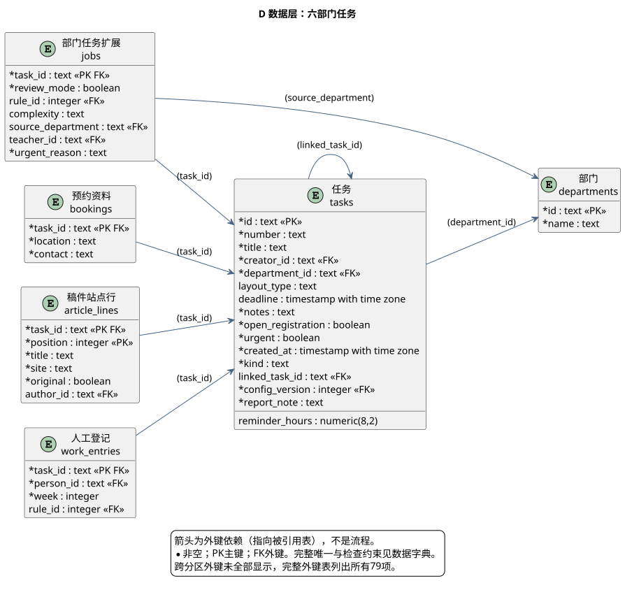
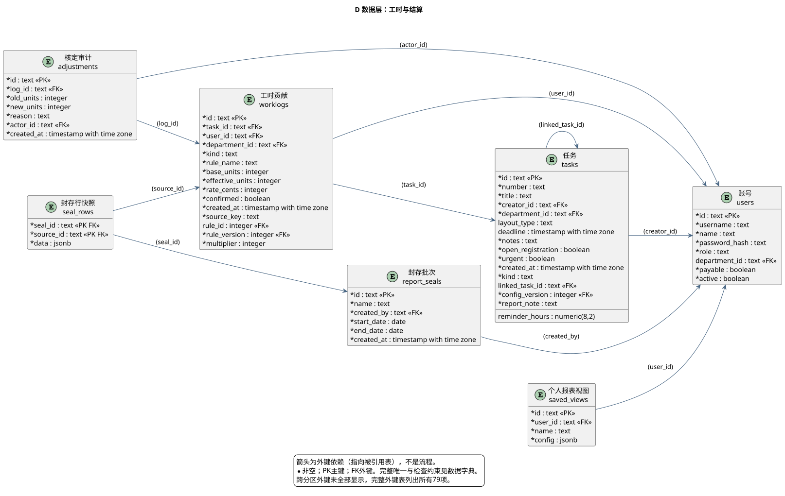
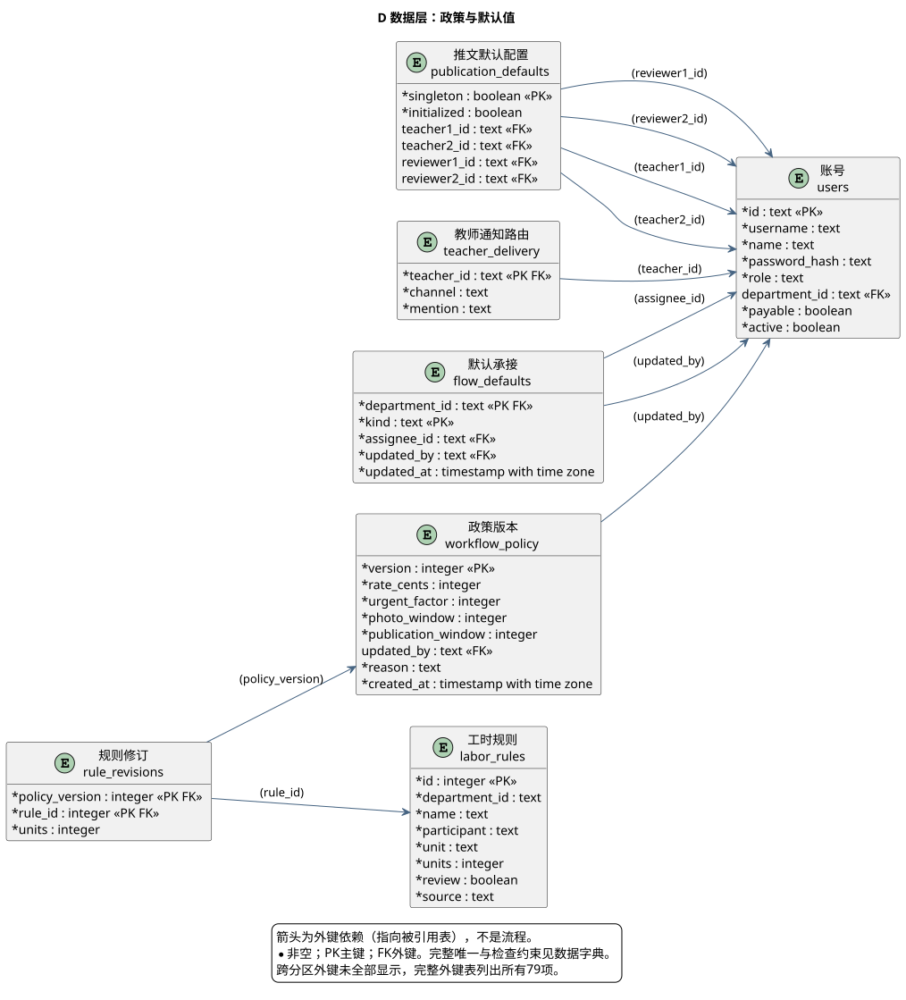
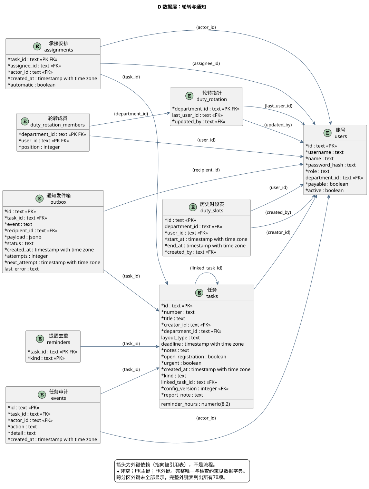

# D 设计模型

## D.1 数据层的精化

当前生产权威数据为CloudBase PostgreSQL环境tccc-qncmzx-d0gxalbv77f0dae9f，业务schema为youth_workbench。云托管通过HTTPS/PostgREST与受控RPC访问，不依赖微型规格未开放的PG TCP连接。本地空库重放相同001–005迁移，用于提取结构与测试，不承载云端权威数据。

业务层实际有38张表、214字段、79外键。结构化关系、复合唯一键、外键和检查约束负责底层一致性；岗位资格、当前审核阶段与计时规则由服务端协调验证。用例与表是多对多关系，不能把每个业务用例直接变成一张表。

### 规范化与必要快照

部门、用户、任务、版本、审核、工时分别保存独立事实，避免名称和角色在每项任务中重复作为权威值。task_reviewers保存岗位安排，reviews保存实际审核；article_lines按稿件站点逐行计量。关联表使用复合键，版本和任务用复合外键防止跨任务误引用。

saved_views.config、outbox.payload与seal_rows.data使用JSONB表示用户视图、通知信封与不可变历史快照，是有明确生命周期的文档值，不代替核心实体关系。worklogs保留当时规则、倍率、费率与来源，属于有意保留的结算依据，不随政策变更回写。

### 字段与关系索引

[完整字段字典](../database/data-dictionary.md)逐表列出类型、非空、默认值、PK/FK/UNIQUE/CHECK和索引；[完整外键关系](../database/foreign-key-relations.md)保留复合列顺序；机器可读结构见[迁移提取结果](../database/runtime-schema.json)。

### 组织身份

### 推文闭环

### 材料与批注

### 六部门任务

### 工时与结算

### 政策与默认值

### 轮转与通知

### 技术表与兼容边界

本地schema_migrations记录迁移执行，不算业务表。云端另外有_state、_requests、_uploads三个支持表，分别管理修订号、幂等请求和对象上传准备/回收；它们不是旧文档型数据库。

duty_slots仍留在迁移结构中，仅为兼容历史；当前代码不以时间段排班，实际使用duty_rotation和duty_rotation_members按先后任务轮转。file_payloads是测试及兼容载荷；云端正式附件在私有对象存储workbench-private，files只保存元数据与完整性哈希。

## D.2 业务层的精化

表示层只提交业务命令。app.js负责HTTP路由、会话、来源校验和输入错误映射；domain.js负责推文，jobs.js负责部门任务，reports.js负责工时与报表，annotations.js负责选区批注。配置、默认承接、轮转与通知各有独立模块。

发布与正常验收把完成事实、archives、worklogs、events及通知意图放在同一事务。唯一约束阻止重复贡献；失败整体回滚。强制关闭写原因且不生成自动工时。小时使用万分之一小时整数，金额使用分；创作者加急倍率与审校分摊分开计算，教师、外部和不符合计酬资格者排除。

云端cloud-db.js先用wb_snapshot读取一致快照，在一次性PGlite工作区运行现有SQL规则，产生变更集，再通过单次wb_command事务以修订号CAS、请求ID和摘要提交。工作区是可丢弃的请求计算材料，权威事实在云端。冲突返回明确失败，调用方刷新后再办，不以本地文件充当生产数据库。

服务端密钥保留在云托管；客户端不得直写业务表或自报角色。云schema对匿名及普通客户端角色撤销直接权限，核心业务只能走经认证的后端。小程序薄网关只允许固定上游和路径，不是第二业务后端。

## D.3 表示层的精化

网页提供登录前介绍、角色首页、按业务分区的任务、详情与版本、精细选区批注、报表列配置与封存、政策与默认承接配置。手机保留蓝色卡片和首页／协作广场／我的三底栏，提供轻量创建、领取、交付、审核、消息、个人记录和工时。

两端请求同一/api/v1契约；Web使用安全会话Cookie，小程序使用Bearer会话经网关转发。所有可见按钮只是提示，服务端再次授权；失败保留输入并解释权限、过期版本或状态冲突。复杂Excel和封存以Web为主，不在手机再造第二套逻辑。

附件上传先完成私有对象准备，再提交元数据，下载必须验权并检查长度与SHA256。批注只标工作台清洗后的预览或正文，不能声称直接在公众号线上页面修改。

## D.4 部署和运行边界

网页/API在CloudBase云托管运行，PG和私有对象存储均在云端，本机关闭不影响正常功能。站内消息已实现；群机器人、订阅消息和微信正式版发布尚未完成，不把outbox记录当成已送达群消息。旧接入环境的薄网关需在2026-12-11试用到期前续期或迁移，详见现有部署文档。
