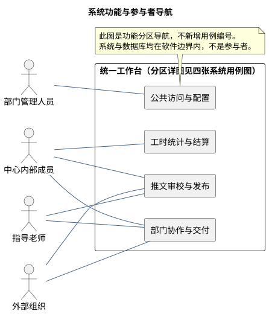
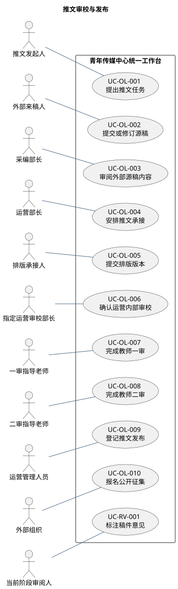
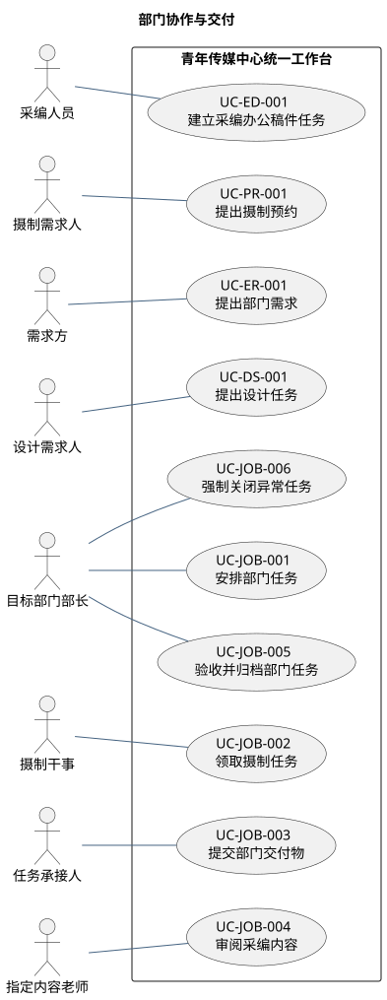
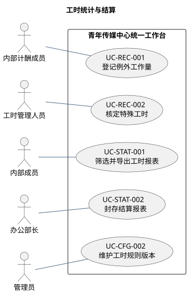
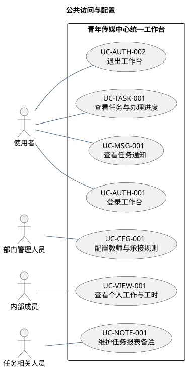

# B 系统用例与参与者

软件边界包括网页、小程序和统一后端。使用者是访问软件的人；中心工作人员在业务组织内部，但在软件边界外，因此属于系统参与者。账号角色与业务岗位不是一一对应：不同任务可指定不同审校人。管理员替代办理范围以规约为准，不能代替指定老师。

一个用例可以关联多个参与者，这是合法UML。本稿按主要责任分区并在规约说明协同及授权替代，减少交叉线；不为减少线条伪造角色继承或删掉真实业务责任。四个详图的编号与规约完全一致。

