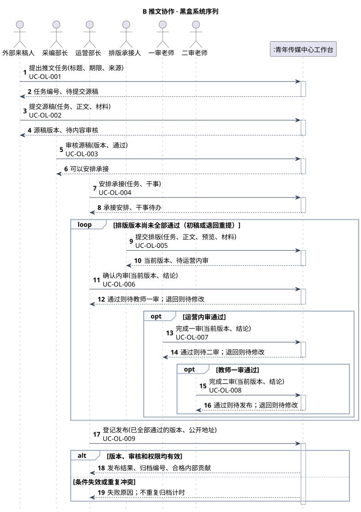
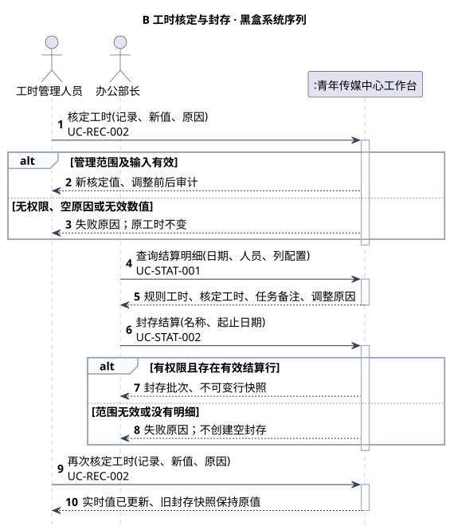

# 系统事件与黑盒序列

本节将青年传媒中心工作台视为一个软件整体。参与者在边界外，系统生命线表示已经建立的工作台实例；这里的矩形是软件对象的标准生命线头，不是业务工人或业务实体。消息采用用户可观察的系统事件，不展开控制、数据库或网络实现。系统事件与前述用例编号对应；C章再以边界、控制、实体展开内部协作。

## 推文协作的系统事件

图示以外部来稿的成功主线为例。源稿退回须修订并重新提交；任何排版审核退回均由承接人提交新版本，重新从运营内部审校开始。两位指定内审部长任一确认即可送教师，一审和二审老师不同。

## 核定与封存的系统事件

核定实时工时和生成结算快照是两个独立用例。封存后仍允许调整实时值，但旧快照不变。失败返回不构成业务完成，教师和外部人员不进入计酬明细。

