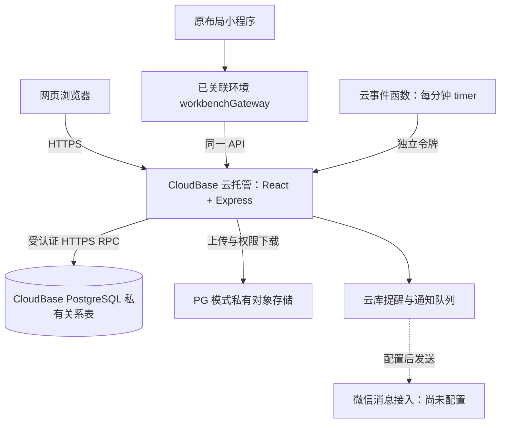

# CloudBase 全云运行方案与实施状态

2026-11-26 已实施。目标环境 `tccc-qncmzx-d0gxalbv77f0dae9f`，上海，共享 PostgreSQL 17.11；云托管 `youth-media-workbench` 004 版本，100% 流量。无需本机运行，也无需购买独占 PG 或云服务器。

网址：https://youth-media-workbench-352447-7-1459171011.sh.run.tcloudbase.com

## 运行架构

关掉开发电脑不会影响网页、API、账号会话、数据、附件和云端调度。云容器 min=0/max=1，可以更换和重启；没有唯一一份生产数据放在容器或本机磁盘。公网 HTTP API 和实际浏览器已验收，无 localhost 请求。平台首次访问提示需点“确定访问”；正式学校域名可后续绑定。

## 数据存放

| 数据 | 云端归属 |
| --- | --- |
| 部门、账号、角色、会话 | departments/users/sessions，私有关系表 |
| 六部门任务、派发、轮值和固定承接 | tasks/jobs/assignments/duty_rotation 等独立表 |
| 新闻稿、版本、逐段批注和审核 | versions/reviews/version_annotations 等关系表 |
| 发布、正常归档、强制关闭 | publications/archives/events；正常完成与计时同事务 |
| 24 条工时规则与版本 | workflow_policy/labor_rules/rule_revisions |
| 工时、加急、核定差值及原因 | worklogs/adjustments；整数单位和金额 |
| 自由筛选视图、封存 | saved_views/report_seals/seal_rows；封存保留原行 |
| 提醒、站内通知和发送重试 | reminders/outbox；未配置机器人真实标记 unconfigured |
| 附件字节 | 私有 bucket workbench-private；files 保存稳定键、所有者、大小和 SHA256 |
| 每日备份 | 同私有存储 backups/YYYY-MM-DD.json，云端任务生成 |
| 命令/上传运行状态 | 私有 _state/_requests/_uploads；客户端无访问权限 |

38 张业务表保持规范的关系模型，主外键和唯一约束都由真实 PostgreSQL 执行。旧 duty_slots 留作历史兼容；生产不再往 file_payloads 放字节。

## HTTPS 如何保留完整事务

现有 Express 业务函数包含多条 SQL 和条件分支。HTTP 网关不提供跨请求连接会话，所以不能拆成 HTTP BEGIN、INSERT、COMMIT，也不能用“传任意 SQL 文本”的公开函数。

实施采用服务端临时 SQL 工作副本与云端版本比较提交：

1. 受限 `wb_snapshot` 一次读取一致云快照和 revision。容器 PGlite 只在内存中运行现有服务端 SQL、权限和业务判断；不持久化、不可离线接单。
2. 每次原业务事务的行变更按顺序捕获，一次提交给 `wb_command`。固定表清单和数据库目录决定可写目标、列和主键，函数不接受 SQL。
3. 云 PG 在单笔事务锁 `_state`，复验有效会话、角色、部门和计时身份，核对 expected_revision，然后应用整笔变更、保存摘要/结果、前进版本。约束失败全部回滚。
4. 其他实例先提交则返回 conflict，API 重新读取并重跑完整业务校验；不会将旧判断直接覆盖新数据。网络丢失响应则同 request_id/摘要重试，云端返回原结果。

这样六部门业务逻辑保持同一份，派发与游标、审核与通知、完成与归档与工时都是一次云端事务。已经实测两个独立实例同时发布和派发、注入归档失败、重复完成、恢复新实例。契约见 specs/004-rotation-and-release/contracts/cloud-http.md。

适用当前学校组织规模：全局 revision 将写入排序，快照包含业务行，后续应监测体积、内存与冲突频率。增长后按任务/报表划分快照和版本；不能将此设计描述为无限规模。

## 安全与附件

- 私有 schema/table 对 anon/authenticated/service_role 撤销直接访问；固定 RPC 仅授 service_role。服务端 Key 不进入网页/小程序，CLI 登录凭据不复制到容器。
- `/api/v1` 继续验证工作台会话、当前责任人、部门、版本和 CSRF，用户不能自报角色。SQL 提交内复验会话状态。
- 文件 prepare → 私有存储 put → 关系元数据提交 → complete。跨存储/PG 不伪称 ACID；失败状态可补偿，定时清理一小时以上且无引用的孤立对象。
- 下载先走任务权限，后由后端读取私有字节并核验大小/散列。外部用户仅能下载自己的材料。
- `/api/v1/health` 实际检查云库，公开仅给 ready/provider；不返回连接串、Key 或内部错误。

## 调度与备份

云函数 workbench-scheduler 已 Active，平台每分钟 timer 已创建，多次云端调用成功。它使用独立令牌调用云域名内部任务接口，可以唤醒没有本机参与的云服务。提醒唯一键、outbox 租约、发送幂等键和失败退避都沿用原逻辑。人为强制零副本的计时验收尚未做；不把本机计时器当作可靠调度。

每日云快照备份已写入私有对象存储。`deployment/cloud-backup.mjs` 可额外导出全部附件；真实恢复演练核对 38 张表、79 条外键、全部行（包括封存 JSON）和附件 SHA256。当前每日备份保存关系快照，附件原对象持久保留；跨环境灾备需另存完整导出包。暂不自动删除历史备份，后续由中心确定保留期限。

## 旧数据及小程序

旧小程序生产集合保持只读参考，未清空、未重置。按最新授权，云端在独立正式管理员之外增加了代表性验收数据：21 个测试账号、47 个任务、38 条工时与 28 份附件，均有验收标识，供用户测试各角色和流程。无需本机在线，也无需本地原始数据。账号指引见 deployment/acceptance-guide.md。

精确历史结算迁移暂不作为本轮前置：旧库已有 2 个成员未匹配账号、2 条周记录未匹配成员等异常，不能把验收造数当作真实应发工时。若后续正式迁移，须先核对成员映射与来源，再比对任务、金额、附件和封存；保留原值，历史归档不重放流程重算。映射见 deployment/legacy-mapping.md。

2026-11-27 小程序已原位替换，保留蓝色卡片与原三底栏，不再保留独立新版入口。`miniprogram/utils/api.js` 通过已关联旧环境的 `workbenchGateway` 调用同一 API，不读写旧文档库；当前网关调用无需手机 HTTP 合法域名。轻量提需求、材料、进度和流转在手机，复杂调度与报表在 Web。旧接入环境 2026-12-11 到期前须续期或迁移网关，详见 [两端统一部署](mini-unification.md)。体验版上传、真机与正式审核发布尚未完成。

微信机器人 endpoint/token 尚未提供：站内通知可用，群发和按老师 @ 尚不能真实发送。填好接入后需单独验收，不冒称已接通。

## 证据与运维

公开健康 200；16 项原业务测试、11 项真实云数据测试、5 项公开域名/浏览器测试和 8 项持久验收数据检查通过。早期临时集成账号已清理；新授权的验收账号和业务样例保留云端，随机密码与正式管理员分开。重复执行数据工具不会重置验收进度。明细见 artifacts/cloudbase/ 和 deployment/README.md。生产 Key 的责任人、轮换与重发步骤也记录在 README。

CloudBase 套餐、云托管、数据库、存储、网关流量与定时函数按实际用量计费。每分钟唤醒可能使容器保持活跃，应结合实际使用调低提醒精度或调整调度频率；不承诺零费用。

## 官方依据

- https://docs.cloudbase.net/skill.md
- https://docs.cloudbase.net/database/postgresql/http/rpc
- https://docs.cloudbase.net/api-reference/webv3/postgresql/rpc
- https://docs.cloudbase.net/storage/pg/introduce
- https://docs.cloudbase.net/run/introduction

最初真实平台探针已清理 Key 和对象，证据在 http-probe.json；那一阶段云托管 002 的 TCP 连接曾返回 503，现被 HTTPS 实施和 004 版本取代。
